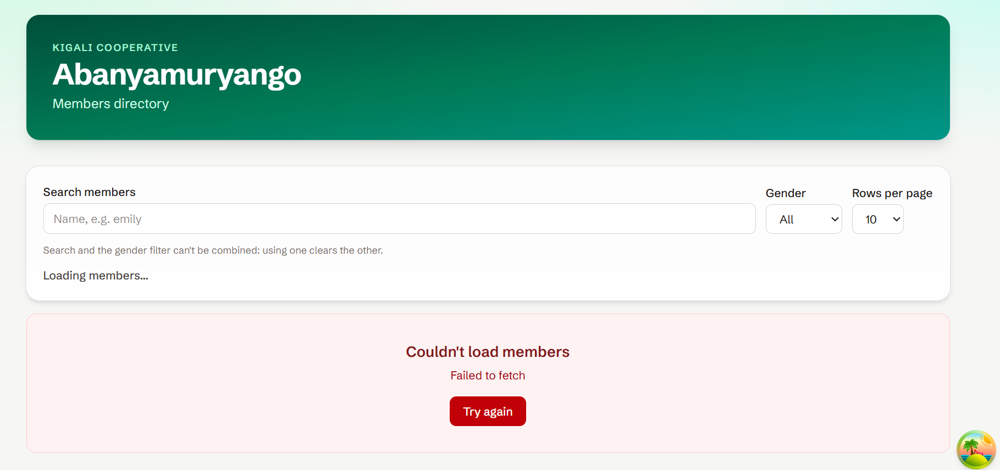

Abanyamuryango · Members Directory

Names: Josephine NIYOMPANO
Live demo: add deployed link

Create the project
Create the Vite React app: "npm create vite@latest members-table -- --template react", then go into the folder: "cd members-table"
Install the packages: "npm install", then "npm i @tanstack/react-query @tanstack/react-query-devtools tailwindcss @tailwindcss/vite"
Add Tailwind to vite.config.js:
js
import { defineConfig } from "vite"
import react from "@vitejs/plugin-react"
import tailwindcss from "@tailwindcss/vite"

export default defineConfig({ plugins: [react(), tailwindcss()] })
Replace everything in src/index.css with:
css
@import "tailwindcss";
Replace src/App.jsx with the App.jsx from this project (main.jsx stays as it is).
Start the app: "npm run dev"
Build and deploy

Build the project with "npm run build", push it to GitHub, then deploy it (for example on Vercel or Netlify) and add the link above.

Built with React, Vite, Tailwind CSS and TanStack Query. The whole app is in src/App.jsx.

Requirements covered
Server-side pagination with page-size selection (10 / 20 / 50), previous/next and page numbers with ellipsis
Server-side sorting on name, email, age and gender, with aria-sort
Debounced search (400 ms) with a clear button
Column filter by gender (the API can't combine search and filter, so using one clears the other)
States: loading skeleton, "Updating…" badge, faded rows while changing pages, empty state with Clear, error state with Retry
URL-synced state (?page=3&sortBy=age&order=desc), so links can be shared and Back/Forward work. Any change except the page resets to page 1.
Next-page prefetching and no skeleton flash between pages
Accessible markup: real <table>, labelled inputs, keyboard support and visible focus
Responsive layout, usable at 360px
Responsive choice

I used a horizontal scroll container with a sticky name column. Every column stays available on phones, and the name stays on screen so each row is easy to identify.

